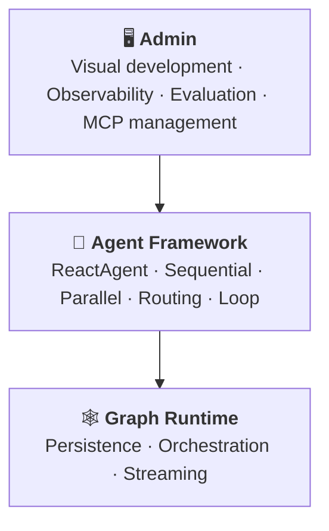

<div align="center">

<a href="https://java2ai.com">
  
</a>

# Spring AI Alibaba

**A production-ready framework for building Agentic, Workflow, and Multi-agent applications on Java and Spring.**

[](https://www.apache.org/licenses/LICENSE-2.0.html)
[](https://github.com/alibaba/spring-ai-alibaba/actions/workflows/build-and-test.yml)
[](https://central.sonatype.com/artifact/com.alibaba.cloud.ai/spring-ai-alibaba/1.1.2.2)
[](https://deepwiki.com/alibaba/spring-ai-alibaba)
[](https://github.com/gitleaks/gitleaks)

[**Agent Framework Docs**](https://java2ai.com/docs/quick-start/) ·
[**Graph Docs**](https://java2ai.com/docs/frameworks/graph-core/quick-start/) ·
[**Spring AI**](https://java2ai.com/ecosystem/spring-ai/reference/concepts/) ·
[**Examples**](https://github.com/alibaba/spring-ai-alibaba/tree/main/examples)

</div>

---

## 📑 Table of Contents

1. [Overview](#-overview)
2. [Architecture](#-architecture)
3. [Core Features](#-core-features)
4. [Getting Started](#-getting-started)
5. [Documentation](#-documentation)
6. [Project Structure](#-project-structure)
7. [Ecosystem](#-ecosystem)
8. [Community](#-community)
9. [Resources](#-resources)
10. [License](#-license)
11. [Star History](#-star-history)

---

## 🔭 Overview

Spring AI Alibaba gives Java developers everything needed to build, run, and manage AI agents. It is organized into three layers that you can adopt together or independently.

| | Component | What it does |
| :-: | --- | --- |
| 🤖 | **Agent Framework** | Build agents fast, with built-in **Context Engineering** and **Human-in-the-Loop** support. |
| 🕸️ | **Graph** | The runtime underneath: persistence, workflow orchestration, and streaming for long-running, stateful agents. |
| 🖥️ | **Admin** | A one-stop platform for visual agent development, observability, evaluation, and MCP management. |

## 🏗️ Architecture



<p align="center">
  
</p>

<table>
<tr>
<td width="33%" valign="top">

### 🖥️ Admin
A one-stop Agent platform for visualized development, observability, evaluation, and MCP management. It integrates with open-source low-code platforms such as **Dify**, enabling rapid migration from DSL to a Spring AI Alibaba project.

</td>
<td width="33%" valign="top">

### 🤖 Agent Framework
Quickly develop agents with built-in **Context Engineering** and **Human-in-the-Loop**. For complex process control, use the built-in workflows: `SequentialAgent`, `ParallelAgent`, `RoutingAgent`, and `LoopAgent`.

</td>
<td width="33%" valign="top">

### 🕸️ Graph
The underlying runtime of the Agent Framework, providing persistence, workflow orchestration, and streaming. Use the Graph API directly for more flexible multi-agent workflows.

</td>
</tr>
</table>

## ✨ Core Features

| | Feature | Description |
| :-: | --- | --- |
| 🧩 | [**Multi-Agent Orchestration**](https://github.com/alibaba/spring-ai-alibaba/tree/main/examples/multiagent-patterns) | Compose agents with built-in patterns (`SequentialAgent`, `ParallelAgent`, `RoutingAgent`, `LoopAgent`) for complex task execution. |
| 🖼️ | [**Multimodal Support**](https://github.com/alibaba/spring-ai-alibaba/tree/main/examples/multimodal) | `ReactAgent` with text and media input (image understanding), plus tool-based image and audio generation. |
| 🎙️ | [**Voice Agent**](https://github.com/alibaba/spring-ai-alibaba/tree/main/examples/voice-agent) | WebSocket-based real-time voice agent: streams audio or text in, responds with generated audio. |
| 🧠 | [**Context Engineering**](https://java2ai.com/docs/frameworks/agent-framework/tutorials/hooks) | Built-in policies for reliability and performance: human-in-the-loop, context compaction and editing, model and tool call limits, tool retry, planning, and dynamic tool selection. |
| 🕸️ | [**Graph-based Workflow**](https://java2ai.com/docs/frameworks/graph-core/quick-start) | Conditional routing, nested graphs, parallel execution, and state management. Export workflows to **PlantUML** and **Mermaid**. |
| 🔗 | [**A2A Support**](https://java2ai.com/docs/frameworks/agent-framework/advanced/a2a) | Agent-to-Agent communication with **Nacos** integration for distributed agent coordination across services. |
| 🔌 | [**Models, Tools and MCP**](https://java2ai.com/integration/chatmodels/dashScope) | Built on Spring AI: multiple LLM providers (DashScope, OpenAI, etc.), tool calling, and Model Context Protocol (MCP). |
| 🚀 | [**One-stop Agent Platform**](https://java2ai.com/ecosystem/admin/quick-start) | Build agents visually, deploy without code, or export as a standalone Java project. |

<p align="center">
  
</p>

## 🚀 Getting Started

### Prerequisites

- ☕ **JDK 17+**
- 🔨 **Maven 3.8+** (optional when using the bundled `mvnw`)
- 🔑 An **API key** from your LLM provider

### Run the ChatBot in 3 steps

A community-provided ChatBot lives in [`examples/chatbot`](https://github.com/alibaba/spring-ai-alibaba/tree/main/examples/chatbot).

**① Download the code**

```shell
git clone --depth=1 https://github.com/alibaba/spring-ai-alibaba.git
cd spring-ai-alibaba
```

**② Set your API key and start the app**

Get a key from [Aliyun Bailian](https://bailian.console.aliyun.com/?apiKey=1&tab=api#/api).

```shell
# This example uses 'spring-ai-alibaba-starter-dashscope'.
# Visit https://java2ai.com to learn how to use OpenAI/DeepSeek.
export AI_DASHSCOPE_API_KEY=your-api-key

# Maven installation is optional when using mvnw.
./mvnw -pl examples/chatbot spring-boot:run
```

**③ Chat**

Open **<http://localhost:8080/chatui/index.html>** in your browser.

<p align="center">
  
</p>

### ChatBot code explained

<details open>
<summary><b>1. Add dependencies</b></summary>

```xml
<dependencies>
  <dependency>
    <groupId>com.alibaba.cloud.ai</groupId>
    <artifactId>spring-ai-alibaba-agent-framework</artifactId>
    <version>1.1.2.0</version>
  </dependency>
  <!-- Assumes a DashScope model. Refer to the docs for how to choose a model. -->
  <dependency>
    <groupId>com.alibaba.cloud.ai</groupId>
    <artifactId>spring-ai-alibaba-starter-dashscope</artifactId>
    <version>1.1.2.1</version>
  </dependency>
</dependencies>
```

</details>

<details open>
<summary><b>2. Define the ChatBot</b></summary>

<br/>

For details on writing a ChatBot, see the [Quick Start](https://java2ai.com/docs/quick-start).

</details>

## 📚 Documentation

| Guide | Description |
| --- | --- |
| [Overview](https://java2ai.com/docs/overview) | High-level overview of the framework. |
| [Quick Start](https://java2ai.com/docs/quick-start) | Get started with a simple agent. |
| [Agent Framework Tutorials](https://java2ai.com/docs/frameworks/agent-framework/tutorials/agents) | Step-by-step tutorials. |
| [Graph API Guide](https://java2ai.com/docs/frameworks/graph-core/quick-start) | Build complex multi-agent systems and workflows with the Graph API. |
| [Spring AI Basics](https://java2ai.com/ecosystem/spring-ai/reference/concepts) | Core concepts: ChatModel, MCP, Tool, Messages, and more. |
| [Chat Memory](https://docs.spring.io/spring-ai/reference/api/chatclient.html#chat-memory) | Spring AI reference for chat memory repositories and usage. |

## 🧱 Project Structure

| Module | Description |
| --- | --- |
| `spring-ai-alibaba-agent-framework` | Multi-agent framework for building intelligent agents with built-in context engineering best practices. |
| `spring-ai-alibaba-graph` | Underlying runtime for the Agent Framework. Using the Agent Framework is recommended, but the Graph API can be used directly. |
| `spring-ai-alibaba-admin` | One-stop Agent platform: visualized development, observability, evaluation, and MCP management. |
| `spring-ai-alibaba-studio` | Embedded UI for quickly debugging agents visually. |
| `spring-boot-starters` | Starters integrating the Agent Framework with Nacos for A2A and dynamic configuration. |

## 🌐 Ecosystem

| Project | Description | Stars |
| --- | --- | :-: |
| [**Graph**](https://github.com/alibaba/spring-ai-alibaba/tree/main/spring-ai-alibaba-graph-core) | Low-level orchestration framework and runtime for building, managing, and deploying long-running, stateful agents. |  |
| [**Admin**](https://github.com/spring-ai-alibaba/spring-ai-alibaba-admin) | Local visualization toolkit for agent development: project management, runtime visualization, tracing, and evaluation. |  |
| [**Extensions**](https://github.com/spring-ai-alibaba/spring-ai-extensions) | Extended implementations of Spring AI core concepts, including DashScopeChatModel and the MCP registry. |  |
| [**Examples**](https://github.com/spring-ai-alibaba/examples) | Spring AI Alibaba examples. |  |
| [**JManus**](https://github.com/spring-ai-alibaba/jmanus) | Java implementation of Manus built with Spring AI Alibaba, used in many applications within Alibaba Group. |  |
| [**DataAgent**](https://github.com/spring-ai-alibaba/dataagent) | Natural-language-to-SQL: query databases in plain language without writing complex SQL. |  |
| [**DeepResearch**](https://github.com/spring-ai-alibaba/deepresearch) | Deep Research implemented on top of `spring-ai-alibaba-graph`. |  |

## 💬 Community

<table>
<tr>
<td align="center" width="50%">

**DingTalk Group (钉钉群)**<br/>
Search `182255021470` and join.<br/><br/>


</td>
<td align="center" width="50%">

**WeChat Official Account (微信公众号)**<br/>
Scan the QR code and follow us.<br/><br/>


</td>
</tr>
</table>

## 📖 Resources

> [!TIP]
> **[AI-Native Application Architecture White Paper](https://developer.aliyun.com/ebook/8479)**
> Co-authored by 40 frontline engineers and endorsed by 15 industry experts, this 200,000+ word white paper is the first comprehensive guide to the full DevOps lifecycle of AI-native applications. It breaks down core concepts and key challenges, with practical problem-solving approaches and architectural insights.

## 📄 License

Released under the [Apache License 2.0](https://www.apache.org/licenses/LICENSE-2.0.html).

## ⭐ Star History

[](https://starchart.cc/alibaba/spring-ai-alibaba)

---

<p align="center">Made with ❤️ by the Spring AI Alibaba Team</p>
