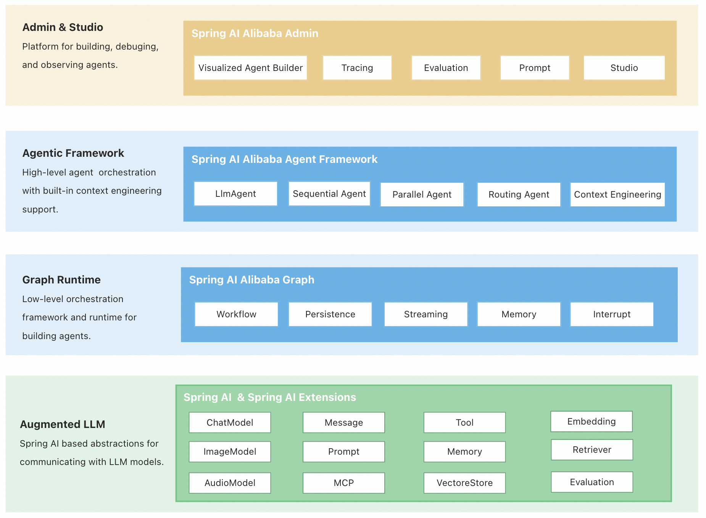
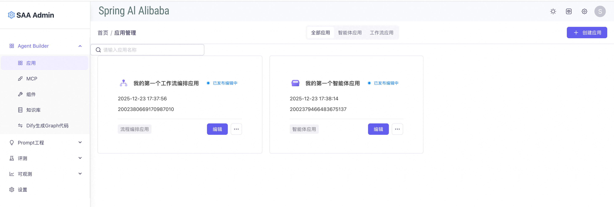
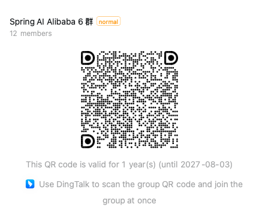

# [Spring AI Alibaba](https://java2ai.com)

[](https://www.apache.org/licenses/LICENSE-2.0.html)
[](https://github.com/alibaba/spring-ai-alibaba/actions/workflows/build-and-test.yml)
[](https://central.sonatype.com/artifact/com.alibaba.cloud.ai/spring-ai-alibaba-bom)
[](https://github.com/gitleaks/gitleaks)

<html>
    <h3 align="center">
      A production-ready framework for building Agentic, Workflow, and Multi-agent applications.
    </h3>
    <h3 align="center">
      <a href="#getting-started">Getting Started</a>,
      <a href="https://java2ai.com/docs/frameworks/graph-core/quick-start/" target="_blank">Graph Docs</a>,
      <a href="https://docs.spring.io/spring-ai/reference/index.html" target="_blank">Spring AI</a>,
      <a href="https://github.com/alibaba/spring-ai-alibaba/tree/main/examples" target="_blank">Examples</a>.
    </h3>
</html>

## Spring AI Alibaba 2.1.0.0

This release uses Spring AI 2.1.0, Spring Boot 4.2.0, Spring AI Alibaba Extensions 2.1.0.0, MCP Java SDK 2.2.0, and Nacos 3.3.0. [Release notes](https://github.com/alibaba/spring-ai-alibaba/releases/tag/v2.1.0.0)

- ReactAgent checks tool calls against the final request and supports human approval, edited arguments, and checkpoint resume. The default per-turn limits are 40 calls per tool and 150 calls across all tools.
- Graph and Studio preserve ordered Message Parts, including reasoning, media, and tool results. The workflow LLM node can use Spring AI Session Memory, and the question classifier can use `DecisionModel` for typed routing decisions.
- The workflow MCP node and Nacos gateway support Modern MCP (2026-07-28), Streamable HTTP, and SSE.
- Extensions update Bailian chat, image, video, audio, and workspace RAG integrations. AnalyticDB, OceanBase, Alibaba OpenSearch, Tablestore, and Tair support writes and searches with precomputed vectors. [Extensions release notes](https://github.com/spring-ai-alibaba/spring-ai-extensions/releases/tag/v2.1.0.0)
- Spring AI 2.1 also adds OpenAI Responses API support, turn-aware session compaction and recall, and normalized model finish reasons. [Spring AI 2.1.0 announcement](https://spring.io/blog/2026/11/20/spring-ai-2-1-0-GA-available-now/)

## Architecture

<p align="center">
    
</p>

**Spring AI Alibaba Admin** is a one-stop Agent platform that supports visualized Agent development, observability, evaluation, and MCP management, etc. It also integrates with open-source low-code platforms like Dify, enabling rapid migration from DSL to Spring AI Alibaba project.

**Spring AI Alibaba Agent Framework** is an agent development framework that can quickly develop agents with built-in **Context Engineering** and **Human In The Loop** support. For scenarios requiring more complex process control, Agent Framework offers built-in workflows like `SequentialAgent`, `ParallelAgent`, `RoutingAgent`, `LoopAgent`.

**Spring AI Alibaba Graph** serves as the underlying runtime of the Agent Framework, providing essential capabilities such as persistence, workflow orchestration, and streaming required for long-running stateful agents. Compared to the Agent Framework, users can build more flexible multi-agent workflows based on the Graph API.

## Core Features

* **[Multi-Agent Orchestration](https://github.com/alibaba/spring-ai-alibaba/tree/main/examples/multiagent-patterns)**: Compose multiple agents with built-in patterns including `SequentialAgent`, `ParallelAgent`, `RoutingAgent`, and `LoopAgent` for complex task execution.

* **[Multimodal Support](https://github.com/alibaba/spring-ai-alibaba/tree/main/examples/multimodal)**: ReactAgent with text and media input (image understanding). ReactAgent with tool based image or audio generation.

* **[Voice Agent](https://github.com/alibaba/spring-ai-alibaba/tree/main/examples/voice-agent)**: WebSocket-based real-time voice agent that supports streaming audio or text input and responds with generated audio.

* **[Context Engineering](https://java2ai.com/docs/frameworks/agent-framework/tutorials/hooks)**: Built-in best practices for context engineering policies to improve agent reliability and performance, including human-in-the-loop, context compaction, context editing, model & tool call limit, tool retry, planning, dynamic tool selection.

* **[Graph-based Workflow](https://java2ai.com/docs/frameworks/graph-core/quick-start)**: Graph based workflow runtime and api for conditional routing, nested graphs, parallel execution, and state management. Export workflows to PlantUML and Mermaid formats.

* **[Graph Engineering](./docs/graph-engineering.md)**: Compose specialized agents or deterministic steps into explicit nodes, edges, shared state, verifier nodes, and distributed A2A handoffs when a single `ReactAgent` loop is no longer enough.

* **[A2A Support](https://java2ai.com/docs/frameworks/agent-framework/advanced/a2a)**: Agent-to-Agent communication support with Nacos integration, enabling distributed agent coordination and collaboration across services.

* **[Rich Model, Tool and MCP Support](https://java2ai.com/integration/chatmodels/dashScope)**: Leveraging core concepts of Spring AI, supports multiple LLM providers (DashScope, OpenAI, etc.), tool calling, and Model Context Protocol (MCP).

* **[One-stop Agent Platform](https://java2ai.com/ecosystem/admin/quick-start)**: Build agent in a visualized way, deploy agent without code or export as a standalone java project.

<p align="center">
    
</p>

## Getting Started

### Run the Chatbot

Use JDK 17 or later and a DashScope API key. The repository includes the Maven Wrapper. [Get a Bailian API key](https://bailian.console.aliyun.com/?apiKey=1&tab=api#/api)

```shell
git clone --depth=1 https://github.com/alibaba/spring-ai-alibaba.git
cd spring-ai-alibaba
export AI_DASHSCOPE_API_KEY=your-api-key
./mvnw -f examples/chatbot/pom.xml spring-boot:run
```

Open the embedded Chat UI once the application starts. [Chatbot UI](http://localhost:8080/chatui/index.html)

<p align="center">
    
</p>

### Add Spring AI Alibaba to Your Project

Use Spring Boot 4.2.0 and import these BOMs. Add the Agent Framework and DashScope starter dependencies to build a ReactAgent with a DashScope chat model. [Chatbot example POM](./examples/chatbot/pom.xml)

```xml
<dependencyManagement>
  <dependencies>
    <dependency>
      <groupId>org.springframework.ai</groupId>
      <artifactId>spring-ai-bom</artifactId>
      <version>2.1.0</version>
      <type>pom</type>
      <scope>import</scope>
    </dependency>
    <dependency>
      <groupId>com.alibaba.cloud.ai</groupId>
      <artifactId>spring-ai-alibaba-extensions-bom</artifactId>
      <version>2.1.0.0</version>
      <type>pom</type>
      <scope>import</scope>
    </dependency>
    <dependency>
      <groupId>com.alibaba.cloud.ai</groupId>
      <artifactId>spring-ai-alibaba-bom</artifactId>
      <version>2.1.0.0</version>
      <type>pom</type>
      <scope>import</scope>
    </dependency>
  </dependencies>
</dependencyManagement>

<dependencies>
  <dependency>
    <groupId>com.alibaba.cloud.ai</groupId>
    <artifactId>spring-ai-alibaba-agent-framework</artifactId>
  </dependency>
  <dependency>
    <groupId>com.alibaba.cloud.ai</groupId>
    <artifactId>spring-ai-alibaba-starter-dashscope</artifactId>
  </dependency>
</dependencies>
```

The runnable example also includes Studio to serve the embedded Chat UI. [Chatbot agent source](./examples/chatbot/src/main/java/com/alibaba/cloud/ai/examples/chatbot/ChatbotAgent.java) · [Studio setup](./spring-ai-alibaba-studio/README.md)

## 📚 Documentation
* [Overview](https://java2ai.com/docs/overview) - High level overview of the framework
* [2.1.0.0 Getting Started](#getting-started) - Run the Chatbot or add the Maven dependencies
* [Agent Framework Tutorials](https://java2ai.com/docs/frameworks/agent-framework/tutorials/agents) - Step by step tutorials
* [Graph Core Quick Start](https://java2ai.com/docs/frameworks/graph-core/quick-start/) - Build a stateful workflow with the Graph API
* [Graph Engineering with Spring AI Alibaba](./docs/graph-engineering.md) - Positioning guide for nodes, edges, shared state, verifier nodes, A2A, and external-agent orchestration
* [Lightweight RepoOps Graph Engineering](./docs/graph-engineering-repoops-lightweight.md) - Single-application RepoOps lifecycle design using Spring AI Alibaba Graph, local agents, tools, and optional A2A
* [Graph Engineering Examples](./examples/graphengineering) - Runnable RepoOps issue workflow using Spring AI Alibaba Graph with AgentScope Java nodes
* [Spring AI Concepts](https://docs.spring.io/spring-ai/reference/concepts.html) - Models, prompts, embeddings, RAG, and tool calling
* [Session Memory migration](https://docs.spring.io/spring-ai/reference/2.1-SNAPSHOT/upgrading/session-memory.html) - Move from `ChatMemory` to Spring AI Session Memory

## Project Structure

This project consists of several core components:

* spring-ai-alibaba-agent-framework: A multi-agent framework designed for building intelligent agents with built-in context engineering best practices.
* spring-ai-alibaba-graph-core — The graph runtime for checkpointing, streaming, and stateful workflows. Use it directly for custom control flow.
* spring-ai-alibaba-admin: A one-stop Agent platform that supports visualized Agent development, observability, evaluation, and MCP management, etc.
* spring-ai-alibaba-studio: The embedded ui for quickly debugging agent in a visualized way.
* spring-boot-starters: Starters integrating Agent Framework with Nacos to provide A2A and dynamic config features.
* examples/graphengineering: Runnable Graph Engineering examples. The current RepoOps issue workflow shows how Spring AI Alibaba Graph owns state and routing while AgentScope Java implements specialist nodes.

## Spring AI Alibaba Ecosystem
 Repository | Description | ⭐
  --- | --- | ---
| [Spring AI Alibaba Graph](https://github.com/alibaba/spring-ai-alibaba/tree/main/spring-ai-alibaba-graph-core) | A low-level orchestration framework and runtime for building, managing, and deploying long-running, stateful agents. | 
| [Spring AI Alibaba Admin](https://github.com/spring-ai-alibaba/spring-ai-alibaba-admin) |  Local visualization toolkit for the development of agent applications, supporting project management, runtime visualization, tracing, and agent evaluation. | 
| [Spring AI Extensions](https://github.com/spring-ai-alibaba/spring-ai-extensions) | Extended implementations for Spring AI core concepts, including DashScopeChatModel, MCP registry, etc. |  
| [Spring AI Alibaba Examples](https://github.com/spring-ai-alibaba/examples) | Spring AI Alibaba Examples. |  
| [JManus](https://github.com/spring-ai-alibaba/jmanus) | A Java implementation of Manus built with Spring AI Alibaba, currently used in many applications within Alibaba Group. | 
| [DataAgent](https://github.com/spring-ai-alibaba/dataagent) | A natural language to SQL project based on Spring AI Alibaba, enabling you to query databases directly with natural language without writing complex SQL. | 
| [DeepResearch](https://github.com/spring-ai-alibaba/deepresearch) | Deep research workflows built with Spring AI Alibaba Graph. | 

## Contact Us

* Dingtalk Group (钉钉群), search `182255021470` and join.



* WeChat Group (微信公众号), scan the QR code below and follow us.


## Resources
* [AI-Native Application Architecture White Paper](https://developer.aliyun.com/ebook/8479): Co-authored by 40 frontline engineers and endorsed by 15 industry experts, this 200,000+ word white paper is the first comprehensive guide dedicated to the full DevOps lifecycle of AI-native applications. It systematically breaks down core concepts and key challenges, offering practical problem-solving approaches and architectural insights.


## Star History

[View star history](https://www.star-history.com/#alibaba/spring-ai-alibaba&Date)

---

<p align="center">
    Made with ❤️ by the Spring AI Alibaba Team
</p>
