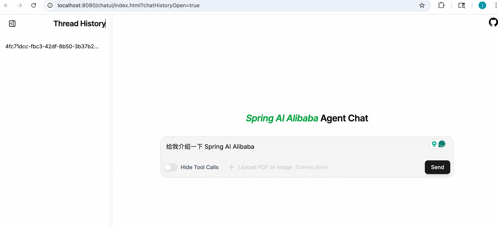

# Agent Chat UI

Agent Chat UI provides a visualized way for developers to chat with any Spring AI Alibaba developed Agents.

## Try the Chatbot

The Chatbot example starts a ReactAgent backend and serves the embedded Chat UI. [Run the Chatbot](../examples/chatbot/README.md)



### Embedded mode

Add Studio to your Spring Boot 4.2 application. The Spring AI Alibaba BOM manages this dependency at version 2.1.0.0. [Maven setup](../README.md#add-spring-ai-alibaba-to-your-project)

```xml
<dependency>
	<groupId>com.alibaba.cloud.ai</groupId>
	<artifactId>spring-ai-alibaba-studio</artifactId>
</dependency>
```

Start your application and open `http://localhost:<port>/chatui/index.html`. Spring Boot uses port 8080 by default.

### Standalone mode

First, clone the repository,

```bash
git clone https://github.com/alibaba/spring-ai-alibaba.git

cd spring-ai-alibaba/spring-ai-alibaba-studio/agent-chat-ui
```

Install dependencies:

```bash
pnpm install
# or
# npm install
```

Run the app:

```bash
pnpm dev
# or
# npm run dev
```

The app will be available at `http://localhost:3000`.

By default, the UI connects to your backend Agent at `http://localhost:8080`, you can change the address at `.env.development` file.

```properties
# .env.development
NEXT_PUBLIC_API_URL=http://localhost:8080
# The agent to call in the backend application, backend application should register agent as required, check examples for how to configure.
NEXT_PUBLIC_APP_NAME=research_agent
NEXT_PUBLIC_USER_ID=user-001
```
